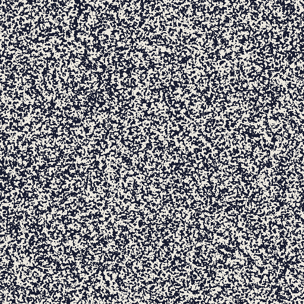
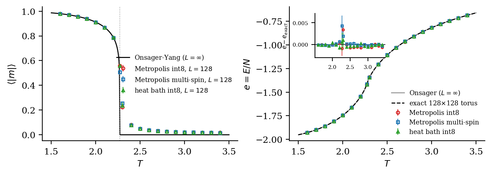
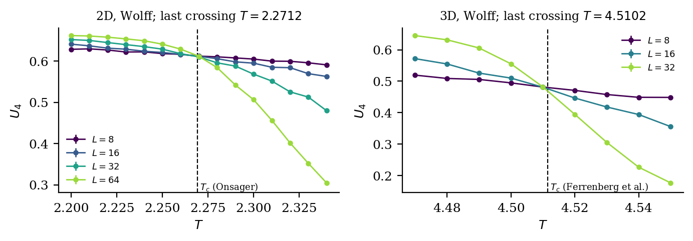
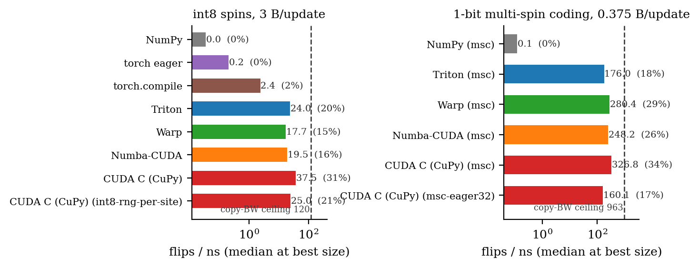
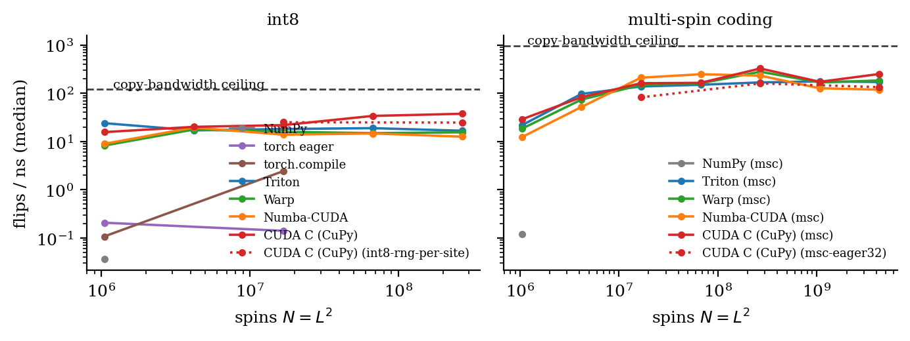

# pyising

**Billions of spin flips per second from Python: 2D/3D Ising Monte Carlo on the GPU across
seven backends, bit-identical results, and a roofline for every rung.**

[](https://github.com/walidhemati/pyising/actions/workflows/ci.yml)
[](LICENSE)
[](pyproject.toml)
[](paper/paper.pdf)

<p align="center">
  
  <br><sub>Domain coarsening after a quench from T = &infin; to T = 1.5 (512&times;512 window of a
  1024&times;1024 lattice, multi-spin-coded CUDA kernel, log-spaced time up to 800 sweeps).</sub>
</p>

## Headline result

<!-- headline:start -->
> **PROVISIONAL**: development run on a shared GPU (`results/provisional.json`); final numbers come from `bench/run.py --full`.

| | |
|---|---|
| **Fastest variant** | CUDA C (CuPy) (msc), L = 16384 |
| **Throughput** | **326.8 spin flips / ns** (2D Metropolis, T = T_c) |
| **% of ceiling** | 33.9 % of measured copy bandwidth (361 GB/s), 27.4 % of nominal (448 GB/s), at 0.375 B/update |
| **Fastest pure-Python-DSL kernel** | Warp (msc): 280.4 flips/ns (29.1 % of copy BW) |
| **GPU** | NVIDIA GeForce RTX 3070 Laptop GPU (single laptop GPU) |
<!-- headline:end -->

## What's inside

| backend | int8 checkerboard (2D/3D, Metropolis + heat bath) | 1-bit multi-spin coding (2D Metropolis) |
|---|---|---|
| NumPy (reference oracle, CI) | yes | yes |
| PyTorch eager | yes | |
| `torch.compile` | yes | |
| Triton | yes | yes |
| NVIDIA Warp | yes | yes |
| Numba-CUDA | yes | yes |
| CUDA C via CuPy `RawModule` (NVRTC) | yes (+ RNG-per-site ablation) | yes (+ eager-32-bit ablation) |

- **Counter-based RNG.** Philox4x32-10 (Random123 known-answer tests pass) keyed by
  (site, sweep, colour, seed), with integer acceptance thresholds: the same seed gives
  **bit-identical spin configurations on every backend**, checked in the test suite.
- **Multi-spin coding.** 64 spins per `uint64`, bit-sliced neighbour counting, and a
  **lazy bitwise comparison** of the uniforms that is exact yet needs only a few Philox calls
  per 64 spins instead of 16.
- **Exact physics checks.** Onsager energy and the *exact finite-torus* energy
  (Kaufman/Ferdinand-Fisher), Onsager-Yang magnetisation, Binder crossings in 2D and 3D (Wolff
  cluster sampler included), 3D T_c vs Ferrenberg, Xu & Landau (2018).
- **Roofline.** Measured copy bandwidth and measured Philox throughput as ceilings; minimal
  traffic model of 3 B/update (int8) and 0.375 B/update (packed bits).

## Quick start

```bash
pip install -e .[gpu]          # or .[triton], .[warp], .[numba], .[cupy]; plain `pip install -e .` = NumPy only
pyising list                   # which backends/variants run on this machine
pyising run --backend triton --variant msc --L 8192 --T 2.0 --sweeps 1000
pyising validate --quick       # physics + bitwise-identity checks (~30 s)
python bench/run.py --quick    # smoke benchmark (< 2 min)
```

```python
from pyising import create, TC_2D
sim = create("cupy-cuda-c", "msc", shape=(16384, 16384), beta=1 / TC_2D, seed=1)
sim.sweep(100)
m, e = sim.observables()
```

## Validation





Checked against: the exact energy of the finite L&times;L torus at every temperature, the
Onsager-Yang spontaneous magnetisation, Onsager's T_c (2D Binder crossing), the simple-cubic
K_c = 0.221654626(5) of Ferrenberg, Xu & Landau (3D Binder crossing), and Wolff cluster
simulations (3D energies). Summary from `results/validation.json`:

<!-- validation:start -->
| check | result |
|---|---|
| bitwise identity across backends | 33 checks, all identical |
| 2D energy vs exact finite torus | max abs error 4.3e-03, max 3.29 sigma |
| 2D abs(m) vs Onsager-Yang (T < T_c - 0.2) | max abs error 3.8e-04 |
| 2D T_c from Binder crossing | 2.2712 (0.09 % from Onsager) |
| 3D T_c from Binder crossing | 4.5102 (0.03 % from Ferrenberg et al. 2018) |
| 3D GPU vs Wolff energies | max 1.19 sigma |
<!-- validation:end -->

## Performance





<!-- table:start -->
Source: `results/provisional.json`.

| backend | variant | L | flips/ns | eff. GB/s | % of copy BW |
|---|---|---:|---:|---:|---:|
| NumPy | int8 | 1024 | 0.04 | 0.1 | 0.0 |
| torch eager | int8 | 1024 | 0.21 | 0.6 | 0.2 |
| torch.compile | int8 | 4096 | 2.42 | 7.2 | 2.0 |
| Triton | int8 | 1024 | 23.97 | 71.9 | 19.9 |
| Warp | int8 | 2048 | 17.66 | 53.0 | 14.7 |
| Numba-CUDA | int8 | 2048 | 19.46 | 58.4 | 16.2 |
| CUDA C (CuPy) | int8 | 16384 | 37.55 | 112.7 | 31.2 |
| CUDA C (CuPy) | int8-rng-per-site | 4096 | 25.05 | 75.1 | 20.8 |
| NumPy | msc | 1024 | 0.12 | 0.1 | 0.0 |
| Triton | msc | 32768 | 176.02 | 66.0 | 18.3 |
| Warp | msc | 16384 | 280.37 | 105.1 | 29.1 |
| Numba-CUDA | msc | 8192 | 248.23 | 93.1 | 25.8 |
| CUDA C (CuPy) | msc | 16384 | 326.76 | 122.5 | 33.9 |
| CUDA C (CuPy) | msc-eager32 | 16384 | 160.06 | 60.0 | 16.6 |
<!-- table:end -->

## How it works

1. **NumPy reference**: compressed checkerboard layout (one array per colour), vectorised
   Philox, integer thresholds. This is the oracle every other backend must match bit for bit.
2. **PyTorch eager / `torch.compile`**: the same algorithm as tensor ops; compile fuses it.
3. **Triton, Warp, Numba-CUDA**: hand-written kernels in Python; one Philox call serves 4 sites.
4. **CUDA C (CuPy/NVRTC)**: the hand-tuned reference (`char4` loads, compile-time sizes).
5. **Multi-spin coding** (Triton, Warp, Numba, CUDA C): 64 spins per word, 8x less traffic;
   the bottleneck moves to the RNG, which the lazy bitwise comparison attacks.

Memory model: a half sweep reads both colour arrays once and writes one, so an update costs
3 spin-sizes of DRAM traffic. Ceilings: `bench/roofline.py` (copy bandwidth, Philox calls/ns).

## Reproduce the paper

```bash
python bench/run.py --full          # < 15 min on an idle GPU -> results/rtx3070-laptop.json
python -m pyising validate          # -> results/validation.json
python figures/make_figures.py      # figures/*.pdf|png, paper/results.tex, README tables
cd paper && tectonic paper.tex      # paper/paper.pdf
```

## Citation

```bibtex
@software{hemati_pyising_2026,
  author  = {Hemati, Walid},
  title   = {pyising: roofline-optimised Ising Monte Carlo on the GPU from Python},
  year    = {2026},
  url     = {https://github.com/walidhemati/pyising},
  license = {MIT}
}
```

MIT licence, see [LICENSE](LICENSE). Metadata in [CITATION.cff](CITATION.cff).

---
<sub>Part of the **Python-HPC suite**:
[pylbm](https://github.com/walidhemati/pylbm) ·
[pyheat3d](https://github.com/walidhemati/pyheat3d) ·
[pygravity](https://github.com/walidhemati/pygravity) ·
[pymd](https://github.com/walidhemati/pymd) ·
[pyising](https://github.com/walidhemati/pyising) ·
[pyspectral](https://github.com/walidhemati/pyspectral)</sub>
